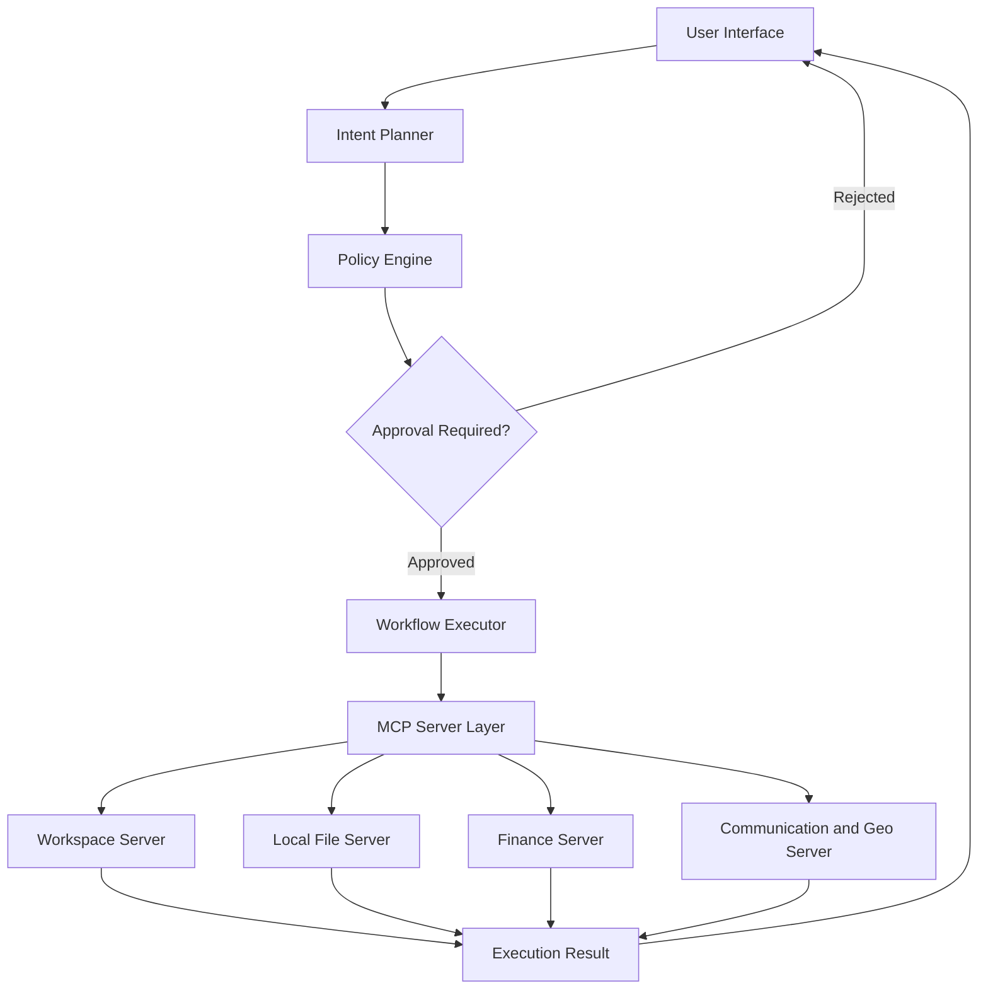
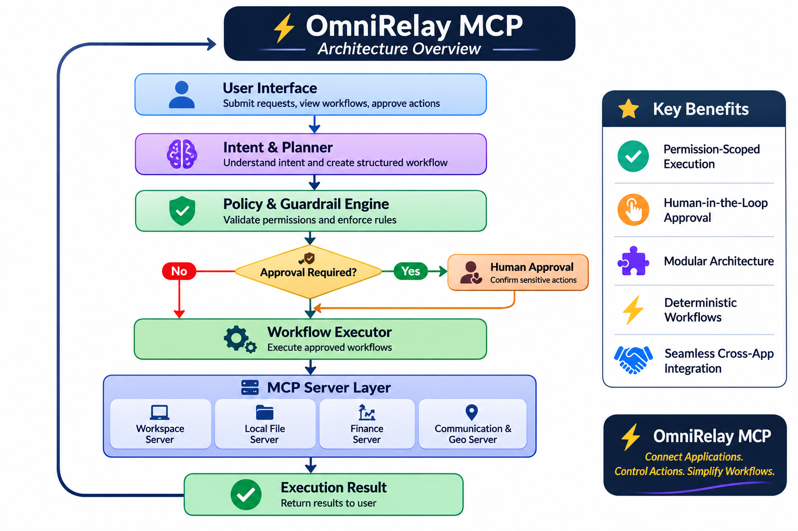

⚡ OmniRelay MCP

Less Magic. More Utility.

Deterministic, Permission-Scoped Cross-App Workflows for Everyday Life.

<p align="center">
  
  
  
  
</p>---

◈ 01. PROJECT OVERVIEW

OmniRelay MCP is a proposed local-first orchestration hub designed to connect everyday applications through structured, verifiable, and permission-controlled workflows.

Instead of relying on disconnected AI actions, OmniRelay introduces a deterministic execution architecture where every workflow follows defined steps, validates permissions, and requests human approval before sensitive operations.

Core Philosophy: AI-Assisted Planning. Deterministic Execution. Human-Controlled Actions.

◈ 02. THE PROBLEM

Modern digital workflows are fragmented across multiple applications.

- Application Silos: Information is scattered across disconnected platforms.
- Repetitive Operations: Manual copy-paste and task coordination consume time.
- Unreliable AI Execution: Uncontrolled actions can create unpredictable results.
- Permission Transparency: Users often lack clear control over automated actions.

◈ 03. THE SOLUTION

OmniRelay MCP proposes a modular orchestration layer built around four core capabilities.

Capability| Function
Typed MCP Interfaces| Structured tool communication
Workflow Orchestration| Defined execution sequences
Policy Enforcement| Permission and action validation
Human-in-the-Loop| Approval before sensitive actions

The goal is to transform disconnected application operations into controlled, reusable workflows.

◈ 04. SYSTEM ARCHITECTURE

## ◈ 04. SYSTEM ARCHITECTURE

OmniRelay MCP follows a four-layer orchestration architecture designed for structured planning, permission validation, and controlled execution.

### Architecture Flow



### Architecture Overview



### Architecture Components

**01 — Client Interface**
- User command input
- Workflow visibility
- Approval interaction
- Execution status monitoring

**02 — Intent & Planner**
- Natural language intent interpretation
- Schema-constrained planning
- Workflow decomposition
- Execution sequence generation

**03 — Policy & Guardrail Engine**
- Role-Based Access Control (RBAC)
- Permission validation
- Action threshold checks
- Human approval requirements
- Execution policy enforcement

**04 — Modular MCP Server Layer**
- Workspace integrations
- Local file operations
- Finance and expense workflows
- Communication and geolocation services

### Execution Lifecycle

1. User submits a request.
2. Intent planner converts the request into structured workflow steps.
3. Guardrail engine validates permissions and policies.
4. Sensitive actions are submitted for human approval.
5. Approved actions are routed to the relevant MCP servers.
6. Execution results are returned to the client interface.


◈ 05. CORE USE CASES

01 — Smart Bill & Split Autopilot

"Gmail → Receipt Extraction → Expense Split → Approval"

Identifies bill information, extracts expense details, and prepares expense-sharing actions for user approval.

Objective: Simplify receipt processing and expense management.

02 — Appointment & Commute Sync

"Messages → Calendar → Maps → Reminder"

Connects appointment information with calendar scheduling and commute planning.

Objective: Reduce manual coordination between communication, scheduling, and navigation applications.

03 — Document & Deadline Concierge

"Documents → Data Extraction → Task Planning → Email Draft"

Extracts relevant information from documents and prepares organised tasks, deadlines, and follow-up email drafts.

Objective: Simplify document management and deadline tracking.

◈ 06. PROPOSED TECHNOLOGY STACK

Layer| Technology
Core Development| Python
Tool Communication| Model Context Protocol (MCP)
Workflow Orchestration| LangGraph
Data Validation| Pydantic
Local Storage| SQLite
Frontend| Next.js
Document Processing| PyMuPDF
AI Planning| Claude / Gemini

These are proposed technologies for the planned implementation. Not all technologies or integrations are currently implemented.


## ◈ 07. REPOSITORY STRUCTURE

OmniRelay MCP follows a modular repository architecture.

### Project Directory Tree

```text
OmniRelay-MCP/
│
├── README.md
├── policy_gate.py
├── requirements.txt
│
├── docs/
│   ├── architecture.md
│   └── use-cases.md
│
├── src/
│   ├── planner/
│   │   └── README.md
│   ├── guardrails/
│   │   └── README.md
│   └── mcp_servers/
│       └── README.md
│
└── assets/
    ├── presentation/
    └── demo/
```

### Directory Description

| Directory / File | Purpose |
|---|---|
| `docs/` | Technical documentation |
| `src/planner/` | Workflow planning |
| `src/guardrails/` | Permission validation |
| `src/mcp_servers/` | MCP integrations |
| `assets/presentation/` | Project PPT |
| `assets/demo/` | Demo video |
| `policy_gate.py` | Initial policy-gate prototype |
| `requirements.txt` | Python dependencies |

### Design Principles

- Modular architecture
- Separation of concerns
- Extensible integrations
- Structured workflows
- Permission-controlled execution


◈ 08. SECURITY & RELIABILITY PRINCIPLES

Permission-Scoped Execution

Actions should operate within authorised boundaries.

Human-in-the-Loop Approval

Sensitive operations should require explicit user confirmation.

Structured Validation

Typed schemas help validate workflow inputs and outputs.

Deterministic Workflows

Defined execution sequences improve predictability and traceability.

Modular Architecture

Independent server modules support extensibility and maintainability.

◈ 09. DEVELOPMENT ROADMAP

Completed

- [x] Project concept and architecture
- [x] Initial policy-gate demonstration
- [x] Project documentation

Planned

- [ ] Core MCP server implementation
- [ ] Workflow orchestration engine
- [ ] External application integrations
- [ ] Human approval interface
- [ ] End-to-end workflow testing

◈ 10. CURRENT IMPLEMENTATION STATUS

OmniRelay MCP is currently at the early prototype and architecture stage.

This repository contains:

- Project architecture and technical documentation
- Defined workflow use cases
- Initial Python policy-gate prototype
- Proposed modular system structure

The complete orchestration engine, external application integrations, and approval interface remain planned development components.

◈ 11. PROJECT PRESENTATION

Project: OmniRelay MCP

Hackathon: wHACKiest 2026

Track: MAKE MCP MATTER — LESS MAGIC, MORE UTILITY

Theme: Deterministic, Permission-Scoped Cross-App Workflows

## 📂 Project Resources

- 📊 [View Project Presentation](assets/OmniRelay_MCP_wHACKiest2026_Deck%20(2).pptx)
- 🎬 [Watch Project Demo](assets/OmniRelay_MCP_Demo.mp4)
- 🏗️ [System Architecture](assets/architecture.png)

---

<p align="center">
  <b>⚡ OMNIRELAY MCP</b>
  <br/>
  <i>Connect Applications. Control Actions. Simplify Workflows.</i>
</p>
