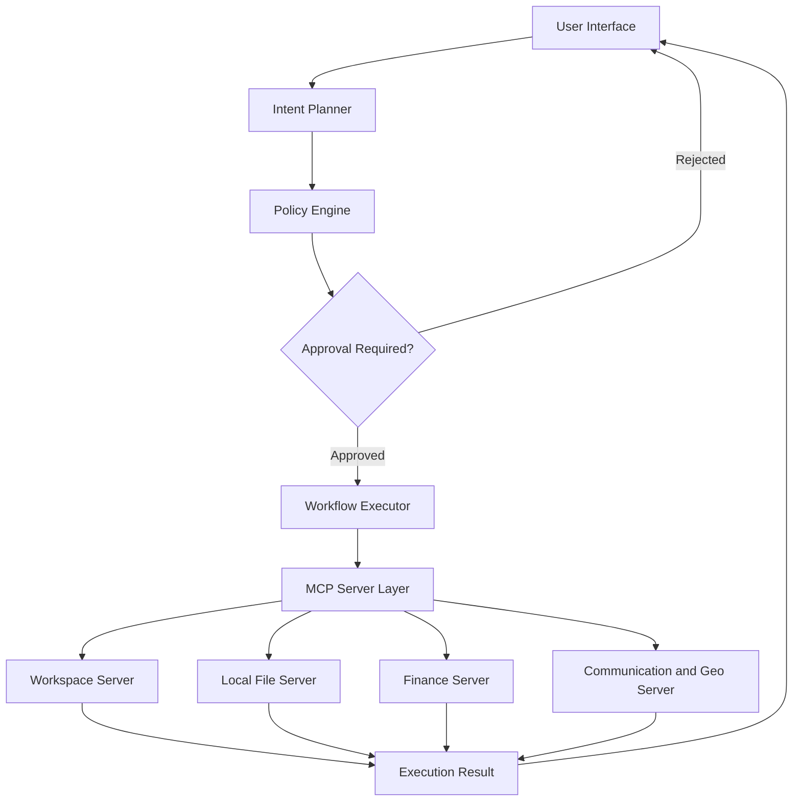

# ⚡ OmniRelay MCP

### Less Magic. More Utility.

**Deterministic, Permission-Scoped Cross-App Workflows for Everyday Life.**

<p align="center">
  
  
  
  
</p>

---

## 💡 01. Project Overview

We use multiple applications every day to manage documents, expenses, appointments and communication. But getting these applications to work together smoothly is still a challenge.

**OmniRelay MCP** is a proposed local-first orchestration hub designed to connect everyday applications through structured, verifiable and permission-controlled workflows.

Instead of relying on disconnected AI actions, OmniRelay introduces a deterministic execution architecture where every workflow follows defined steps, validates permissions and requests human approval before sensitive operations.

> **Core Philosophy:** AI-Assisted Planning. Deterministic Execution. Human-Controlled Actions.

---

## 🎯 02. The Problem

Modern digital workflows are fragmented across multiple applications.

- **Application Silos:** Information is scattered across disconnected platforms.
- **Repetitive Operations:** Manual copy-paste and task coordination consume time.
- **Unreliable AI Execution:** Uncontrolled actions can create unpredictable results.
- **Permission Transparency:** Users often lack clear control over automated actions.

---

## 🚀 03. The Solution

OmniRelay MCP proposes a modular orchestration layer built around four core capabilities.

| Capability | Function |
|:---|:---|
| 🔗 Typed MCP Interfaces | Structured tool communication |
| ⚙️ Workflow Orchestration | Defined execution sequences |
| 🛡️ Policy Enforcement | Permission and action validation |
| 👤 Human-in-the-Loop | Approval before sensitive actions |

The goal is to transform disconnected application operations into controlled, reusable workflows.

---

## 🏗️ 04. System Architecture

OmniRelay MCP follows a four-layer orchestration architecture designed for structured planning, permission validation and controlled execution.

### Architecture Flow



### Architecture Overview


### Architecture Components

**01 — Client Interface**
- User command input
- Workflow visibility
- Approval interaction
- Execution status monitoring

**02 — Intent & Planner**
- Natural language intent interpretation
- Schema-constrained planning
- Workflow decomposition
- Execution sequence generation

**03 — Policy & Guardrail Engine**
- Role-Based Access Control (RBAC)
- Permission validation
- Action threshold checks
- Human approval requirements
- Execution policy enforcement

**04 — Modular MCP Server Layer**
- Workspace integrations
- Local file operations
- Finance and expense workflows
- Communication and geolocation services

### Execution Lifecycle

1. User submits a request.
2. Intent planner converts it into structured workflow steps.
3. Guardrail engine validates permissions and policies.
4. Sensitive actions are submitted for human approval.
5. Approved actions are routed to the relevant MCP servers.
6. Execution results are returned to the client interface.

---

## 🌍 05. Core Use Cases

### 01 — Smart Bill & Split Autopilot

`Gmail → Receipt Extraction → Expense Split → Approval`

Identifies bill information, extracts expense details and prepares expense-sharing actions for user approval.

**Objective:** Simplify receipt processing and expense management.

### 02 — Appointment & Commute Sync

`Messages → Calendar → Maps → Reminder`

Connects appointment information with calendar scheduling and commute planning.

**Objective:** Reduce manual coordination between communication, scheduling and navigation applications.

### 03 — Document & Deadline Concierge

`Documents → Data Extraction → Task Planning → Email Draft`

Extracts relevant information from documents and prepares organised tasks, deadlines and follow-up email drafts.

**Objective:** Simplify document management and deadline tracking.

---

## 🧰 06. Proposed Technology Stack

| Layer | Technology |
|:---|:---|
| Core Development | Python |
| Tool Communication | Model Context Protocol (MCP) |
| Workflow Orchestration | LangGraph |
| Data Validation | Pydantic |
| Local Storage | SQLite |
| Frontend | Next.js |
| Document Processing | PyMuPDF |
| AI Planning | Claude / Gemini |

*These are proposed technologies for the planned implementation. Not all technologies or integrations are currently implemented.*

---

## 📁 07. Repository Structure

OmniRelay MCP follows a modular repository architecture.

### Project Directory Tree

```text
OmniRelay-MCP/
│
├── README.md
├── policy_gate.py
├── requirements.txt
│
├── docs/
│   ├── architecture.md
│   └── use-cases.md
│
├── src/
│   ├── planner/
│   │   └── README.md
│   │
│   ├── guardrails/
│   │   └── README.md
│   │
│   └── mcp_servers/
│       └── README.md
│
└── assets/
    ├── architecture.png
    ├── demo-thumbnail.png
    ├── OmniRelay_MCP_Demo.mp4
    └── OmniRelay_MCP_wHACKiest2026_Deck (2).pptx
```

### Directory Description

| Directory / File | Purpose |
|:---|:---|
| `docs/` | Technical documentation |
| `src/planner/` | Workflow planning |
| `src/guardrails/` | Permission validation |
| `src/mcp_servers/` | MCP integrations |
| `assets/` | Architecture, presentation and demo resources |
| `policy_gate.py` | Initial policy-gate prototype |
| `requirements.txt` | Python dependencies |

### Design Principles

- Modular architecture
- Separation of concerns
- Extensible integrations
- Structured workflows
- Permission-controlled execution

---

## 🔐 08. Security & Reliability Principles

**🛡️ Permission-Scoped Execution**

Actions should operate within authorised boundaries.

**👤 Human-in-the-Loop Approval**

Sensitive operations should require explicit user confirmation.

**📋 Structured Validation**

Typed schemas help validate workflow inputs and outputs.

**⚙️ Deterministic Workflows**

Defined execution sequences improve predictability and traceability.

**🔌 Modular Architecture**

Independent server modules support extensibility and maintainability.

---

## 🛣️ 09. Development Roadmap

### 

- [x] Project concept and architecture
- [x] Initial policy-gate demonstration
- [x] Project documentation

### 

- [ ] Core MCP server implementation
- [ ] Workflow orchestration engine
- [ ] External application integrations
- [ ] Human approval interface
- [ ] End-to-end workflow testing

---

## 📌 10. Current Implementation Status

OmniRelay MCP is currently at the **early prototype and architecture stage**.

### Currently Available

- Project architecture and technical documentation
- Defined workflow use cases
- Initial Python policy-gate prototype
- Proposed modular system structure

### Planned Development

- Complete orchestration engine
- External application integrations
- Human approval interface

The project is presented with a clear distinction between the existing prototype and future implementation goals.

---

## 📂 11. Project Resources

Explore the project presentation, demonstration video and system architecture.

### 🎬 Project Demo Video

<p align="center">
  <a href="https://github.com/Rahidxx/OmniRelay-MCP/raw/refs/heads/main/assets/OmniRelay_MCP_Demo.mp4">
    
  </a>
</p>

<p align="center">
  <a href="https://github.com/Rahidxx/OmniRelay-MCP/raw/refs/heads/main/assets/OmniRelay_MCP_Demo.mp4">
    
  </a>
</p>

### 📊 Project Presentation

<p align="center">
  <a href="assets/OmniRelay_MCP_wHACKiest2026_Deck%20(2).pptx">
    
  </a>
</p>

### 🏗️ System Architecture

[View Architecture Diagram](assets/architecture.png)

---

## 🏆 12. Hackathon Information

| Detail | Information |
|:---|:---|
| Project | OmniRelay MCP |
| Hackathon | wHACKiest 2026 |
| Track | MAKE MCP MATTER |
| Theme | Less Magic, More Utility |
| Focus | Deterministic, Permission-Scoped Cross-App Workflows |

---

<p align="center">
  
</p>

<h2 align="center">⚡ OmniRelay MCP</h2>

<p align="center">
  <i>Connect Applications. Control Actions. Simplify Workflows.</i>
</p>

<p align="center">
  Less Magic. More Utility.
</p>
